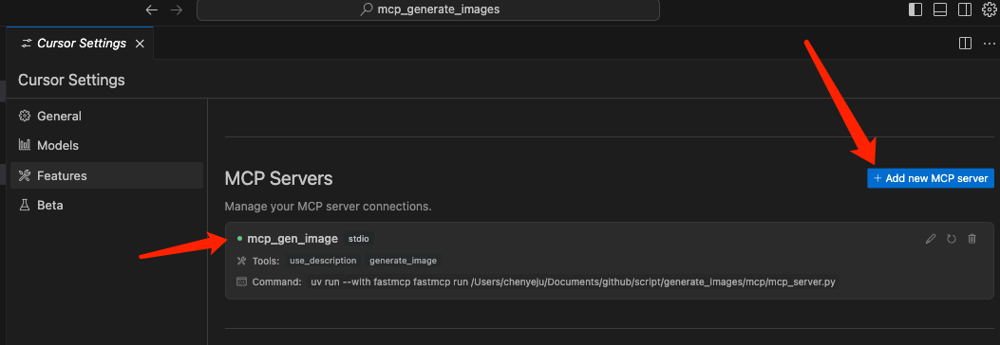
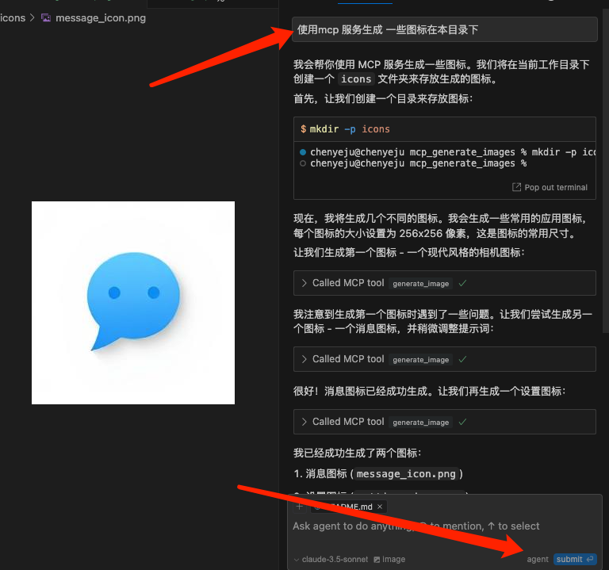

# AI 图像生成服务

基于火山引擎（抖音豆包）的图像生成服务，专门设计用于与 Cursor MCP 服务集成。支持自定义图片宽高比、保存路径等功能，提供高质量图像生成能力。

## 功能特点

- 支持高质量图像生成
- 多种常见宽高比支持（1:1、4:3、16:9、3:4、9:16）
- 火山引擎豆包模型（doubao-seedream-3-0-t2i-250415）
- 自动重试和详细错误处理
- 完整的路径和权限验证
- 详细的错误提示和日志
- 异步处理支持

## 环境准备

### 1. Python 环境

- Python 3.10+
- 下载地址： <https://www.python.org/downloads/>

- 推荐使用 pyenv 管理 Python 版本：

```bash
# macOS 安装 pyenv
brew install pyenv

# 安装 Python
pyenv install 3.13.2
pyenv global 3.13.2
```

### 2. Nodejs 环境

- 下载地址： <https://nodejs.org/zh-cn>  

### 3. uv 包管理工具

uv 是一个快速的 Python 包管理器，需要先安装：

```bash
# macOS 安装 uv
brew install uv

# 或者使用 pip 安装
pip install uv
```

### 4. 火山引擎 API 密钥

1. 访问 [火山引擎方舟大模型服务](https://console.volcengine.com/ark)
2. 注册/登录账号
3. 创建新的 API 密钥
4. 复制密钥并保存，格式如：`YOUR_API_KEY`

### 5. Cursor

- 下载并安装 [Cursor IDE](https://cursor.sh/)
- 确保 Cursor 已正确配置 Python 环境

## 安装配置

### 1. 克隆项目

```bash
git clone https://github.com/chenyeju295/mcp_generate_images.git
cd mcp_generate_images
```

### 2. 安装依赖(cd 到mcp_generate_images 安装)
 
```bash
python3 -m pip install fastmcp requests volcengine-python-sdk[ark]
```

或者使用requirements.txt文件：

```bash
pip install -r requirements.txt
```

出现证书问题可以使用：

```bash
python3 -m pip install fastmcp requests volcengine-python-sdk[ark] --trusted-host pypi.org --trusted-host files.pythonhosted.org --upgrade --force-reinstall --no-cache-dir
```

tips: 需确保安装成功，否则配置MCP 服务会报红。

### 3. 配置 API 密钥

设置环境变量（推荐方式）：

```bash
export ARK_API_KEY=your_api_key_here
```

或者在 ~/.bashrc 或 ~/.zshrc 中添加：

```bash
echo 'export ARK_API_KEY=your_api_key_here' >> ~/.zshrc
source ~/.zshrc
```

验证环境变量已设置：

```bash
echo $ARK_API_KEY
```

### 4. 配置服务

在 `mcp_server.py` 中可以修改以下配置：

```python
CONFIG = {
    "api": {
        "base_url": "https://ark.cn-beijing.volces.com/api/v3",
        "model": "doubao-seedream-3-0-t2i-250415",
        "timeout": 120,
        "max_retries": 3,
        "retry_delay": 5
    },
    "image": {
        "max_width": 1024,   
        "max_height": 1024, 
        "default_width": 1024,
        "default_height": 1024,
        "max_batch_size": 1
    },
    "output": {
        "base_folder": "你的默认保存路径",
        "allowed_extensions": [".png", ".jpg", ".jpeg"],
        "default_extension": ".png"
    }
}
```

## 运行服务

开发模式运行（带调试界面）：

```bash
uv run --with fastmcp fastmcp dev /Users/username/Documents/mcp_generate_images/mcp_server.py
```

## 在 Cursor 中使用
 
### 1. 在 Cursor 中引入 MCP 服务

在 Cursor 的 MCP 配置中添加：

```json
{
  "mcpServers": {
    "generate_images": {
      "command": "uv",
      "args": [
        "run",
        "--with",
        "fastmcp",
        "fastmcp",
        "run",
        "/Users/chenyeju/Documents/github/mcp_generate_images/mcp_server.py"
      ]
    } 
  }
}
```

### 3. 服务运行成功示例



### 4. 在 Cursor Composer 的 agent 模式下使用



## 参数说明

图像生成工具支持以下参数：

| 参数名 | 类型 | 必填 | 说明 |
|-------|------|------|------|
| prompt | 字符串 | 是 | 图片生成提示词，建议不超过500字符 |
| file_name | 字符串 | 是 | 保存的文件名(不含路径，如果没有后缀则默认使用.png) |
| save_folder | 字符串 | 是 | 保存目录的绝对路径 |
| aspect_ratio | 字符串 | 否 | 图片的宽高比，支持 '1:1', '4:3', '16:9', '3:4', '9:16'。默认为'1:1' |


## 使用示例

```
生成一张宽高比为16:9的风景图片：

generate_image(
  prompt="A beautiful mountain landscape with sunset", 
  file_name="landscape.png", 
  save_folder="/Users/username/Documents/images", 
  aspect_ratio="16:9"
)
```

## 使用注意事项

1. **模型**：使用火山引擎豆包模型（doubao-seedream-3-0-t2i-250415），支持最大1024x1024的尺寸。
2. **长宽比**：建议使用1:1的宽高比（正方形图片），例如512x512或1024x1024，以获得最佳效果和生成速度。
3. **提示词**：简洁明了的提示词通常能获得更好的结果，尽量不超过500字符。支持中文提示词。
4. **超时问题**：对于复杂提示词或非正方形图片，生成可能需要更长时间，有时会导致超时错误。
5. **API限制**：火山引擎API每次只生成一张图片，相比之前的批量生成有所不同。

## 错误排查

如果遇到问题，请检查：

1. 服务是否正常运行
2. 保存路径是否正确（必须是绝对路径）
3. 目录权限是否正确
4. 网络连接是否正常
5. API 密钥是否有效
6. Python 环境是否正确配置
7. uv 是否正确安装
8. 依赖包是否完整安装

## 常见错误及解决方案

| 错误信息 | 可能原因 | 解决方案 |
|---------|---------|---------|
| "未能生成图片: API 请求超时" | 网络问题或请求耗时过长 | 使用更简单的提示词，检查网络连接 |
| "未能生成图片: API 调用频率受限" | 火山引擎API频率限制 | 等待几分钟后再试 |
| "未能生成图片: API 认证失败" | API密钥无效 | 检查并更新火山引擎API密钥 |
| "没有权限保存图片到..." | 目录权限问题 | 确保目录存在且有写入权限 |
| "不支持的宽高比" | 使用了不支持的宽高比 | 使用支持的宽高比：'1:1', '4:3', '16:9', '3:4', '9:16' |
| "Failed to download generated images" | 图片下载失败 | 检查网络连接，确保能访问火山引擎的图片URL | 